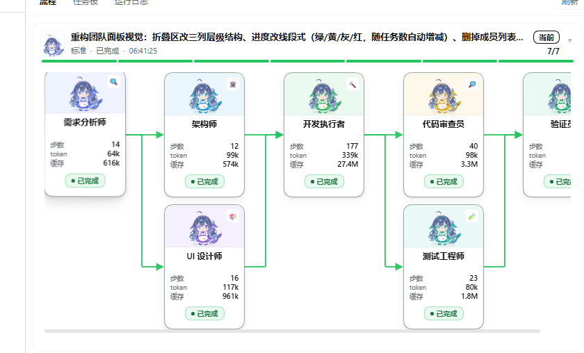
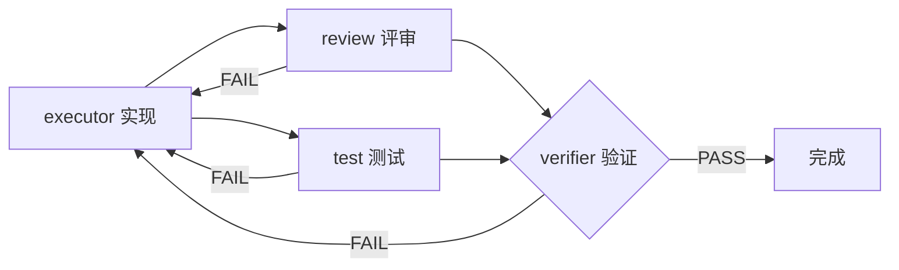

<div align="center">

# DSH Teams

**任务感知的多角色团队流水线 —— 把"团队协作"从提示词下沉到宿主代码**


一句话就能把复杂任务交给一支分工明确的团队：
**需求分析 → 架构 → 实现 → 评审 ‖ 测试 → 验证**。
不是让模型"扮演一套流程"，而是由宿主代码强制进度、质量门与返工。



</div>

---

## 它解决什么问题

让模型"扮演团队"是不可靠的：进度靠它自觉写状态、质量靠它自己打分、失败靠超时兜底。
本插件把这些纪律**从提示词搬进宿主代码**，每一条都能被测试验证：

| 环节 | 常规做法（提示词） | 本插件的做法（代码） |
|---|---|---|
| 走哪条路径 | 模型自己判断 | 三维评分**纯函数**算出来，附可解释理由 |
| 进度记在哪 | 模型写在回复里，忘了就没了 | 工具写入的**结构化任务记录** |
| 是否完成 | 模型自称"已完成" | 门类任务必须给出 `VERDICT: PASS\|FAIL\|BLOCKED`，**缺失按未通过处理** |
| 有没有证据 | 模型说"我验证过了" | PASS 也要能复核（文件:行号 / 命令+退出码 / 明确的"不适用"） |
| 评审不通过 | 模型说"我改好了" | **自动把实现步骤退回重做**，轮数受 `maxReviewRounds` 限制 |
| 失败了怎么办 | 一直重试或直接卡死 | 熔断器三态机 + 分级冷却 + 错误分类恢复表 |

---

## 五条路径

按任务复杂度自动选路径，也可以 `force_path` 显式指定（安全相关不会被降级）：

| 路径 | 角色链 | 适用 |
|---|---|---|
| **快速** | Executor → Code-Reviewer → Verifier | 单点小改 |
| **标准** | Analyst →（UI-Designer）→ Architect → Executor → Code-Reviewer ‖ Test-Engineer → Verifier | 功能扩展 |
| **完整** | Analyst →（UI-Designer）→ Architect → Critic → Executor → Code-Simplifier ‖ Code-Reviewer ‖ Security-Reviewer ‖ Test-Engineer → Verifier | 跨模块 / 安全相关 |
| **调试** | Debugger → Executor → Code-Reviewer → Verifier | 报错排查 |
| **部署** | DevOps → Deploy-Auditor → Verifier | 发布上线 |
| **调试·安全** | Debugger → Executor → Code-Reviewer ‖ Security-Reviewer → Verifier | 安全相关模块的 bug |

`‖` 表示可并行。UI 设计步骤按需插入：任务描述命中界面/交互类关键词才进链。

<details>
<summary><b>路由评分规则</b></summary>

```
scale : 单文件≤20行=0 | 2-5文件≤200行=1 | >5文件或>200行=2
impact: 无依赖影响=0 | 同模块内=1 | 跨模块/跨服务=2
risk  : 纯样式注释=0 | 功能扩展/间接安全=1 | 认证·支付·直接安全=2

1) 风险=2 且是调试任务 → 调试（含安全审查）
2) 风险=2 其它        → 完整路径（短路，不被用户指定降级）
3) 三维加和 0-1 → 快速 | 2-4 → 标准 | 5-6 → 完整
4) 调试/部署关键词覆盖（仅在低于完整路径时生效）
5) 未提供改动量时规模取保守中位数，不乐观假设"小改"
6) UI 变更且规模来自推断时向上加权一档
```

安全词表分两档：`认证/支付/凭据/注入` 这类**直接命中即高风险**；
`会话/令牌/sql` 这类**歧义词必须配安全语境**（如「会话**劫持**」「token **泄露**」）才算——
否则「给面板加**子会话**跳转」会被误判成安全任务、白走完整路径（已修复并有回归）。

</details>

---

## 质量门

三个门是机器判定的，不是模型自己说通过就通过：



- **fail-closed**：`VERDICT` 必须独立成行、不裹代码围栏；缺失、多个、或出现在结论之外的都按未通过处理
- **返工**：任一门 FAIL，实现步骤被重新排队，驳回意见注入新任务卡；轮数超 `maxReviewRounds` 后**不再判失败**——任务标为 `blocked` 并带 `needsDecision`（`kind: 'review-budget'`，含轮次与 findings 摘要），团队阶段收口为 `needing-decision`，面板显示「需队长决策」。原因是评审常要求改 `in_scope` 之外的文件，而执行者被任务卡禁止，永远做不到；继续判失败只会把返工预算烧在不可能收敛的地方。改范围或方案后用 `teams_retry` 续跑，已完成的步骤不会重做
- **评审范围**：评审/验证任务卡要求只对**本次改动范围内**的问题判 FAIL；范围外的发现单列「范围外发现」小节，只作提示、不作 FAIL 依据（安全类例外需注明是否为本次引入）。安全审查 FAIL 仍是终局阻断，语义不变，但 findings 同样会带出来
- **世代隔离**：返工产生新 `epoch`，在飞的旧结果直接丢弃，不会覆盖新结论
- **批准即锁定**：`approvedAt` 与任务图指纹绑定，改了图就必须重新批准
- **交接截断**：单条依赖产物上限 6000 字、单个任务卡总量 24000 字。超限时不再从开头硬切，而是**保留开头 + 全部「路径:行号」证据行 + 结尾结论**（`VERDICT` 一定能留下），并标注省略了多少字

---

## 角色

内置 16 个，只读；自定义角色可在设置页增删改：

```
orchestrator  analyst  architect  critic  ui-designer  executor
code-simplifier  debugger  code-reviewer  security-reviewer
test-engineer  verifier  devops  deploy-auditor  explore  document-specialist
```

每个角色是一份**契约**，而不是一段人设描述：

```markdown
# 你是 <角色名>
## 权限边界       可以 / 不可以 / 越界信号
## 工作步骤       编号、严格按序
## 输出契约       固定小标题（结论 / 证据 / 变更清单 / 未确认项 / 建议下一步）
## 预算与纪律     读取上限、输出上限、禁止事项
```

> 契约里写"读到第 6 个文件就停"，比写"请谨慎高效"有用得多。

**权限档（readonly / readwrite / execute）不是运行时沙箱。** 宿主的工具作用域（`toolFilter`）只经 agentPreset / descriptor 通路生效，一次性派发拿不到，所以档位对子代理而言**只是提示词约束**：它写在契约与角色元数据里，运行期不会被强制执行。越界靠**事后检测**——子代理结束后扫描它自己的会话事件，发现 `write` / `edit` / `bash` / `pwsh` 这类写操作时，把 `permissionViolation` 记进该任务的 evidence，并往事件流追加一条 `warn`（团队面板可见），不改变任务状态、不冒充失败。审计后如实改掉过去"工具作用域按角色裁剪"的说法。

自定义角色支持**触发词**：任务描述命中时自动插进流水线（例如给 `db-tuning` 配 `索引/慢查询`）。匹配按**词边界**：`ui` 不会因为 `build` 而命中、`go` 不会因为 `google` 而命中，中文仍按子串匹配。

---

## 团队工作视图

在 DSH 右栏打开「团队」标签页：

- **依赖图**：角色卡片按拓扑层级排布，直角折线连接；鼠标悬停高亮完整上下游链，点击钉住查看详情
- **线段式进度**：一段一个任务，绿=完成 / 黄=进行中 / 灰=未开始 / 红=失败；任务增多自动增段
- **四种连线状态**：完成绿、失败红、指向进行中的黄（带流光）、未到达灰虚线
- **点卡片或成员 → 打开该子代理的会话**：直接看它在干什么
- **停止按钮**在运行行标题旁，带确认框（显示未完成任务数与忙碌成员数）
- **审批区在流程图下方、占满整行**：「批准并启动」是品牌色实心大按钮，「不批准，再商议」是描边次按钮。
  当前轮待审批时即使步骤很多也默认展开（审批入口不会藏在折叠体里）；
  点「批准并启动」后整块审批区**立即消失**（乐观 UI）：成功则保持消失直到进入运行中；
  失败（含被拒）则原地恢复并给出真实原因。若批准成功但启动失败（例如该会话当前没有活动的 Agent），
  界面如实显示「已批准，但启动失败」，主按钮降级为「启动」并保留可重试——
  不会把已批准说成「批准失败」，也不会把按钮藏起来让你无处可点
- **不批准，再商议**：点开只展开多行输入框，**不发起任何请求**；提交的修改意见写入团队记录
  （`team.notes`），之后每次派发都会随任务卡带给子代理（没有消费水位），已在跑 / 已完成的任务不受影响
- 卡片的阶段文案按 `approvedAt` 判断：已批准但还没跑时显示「已批准 · 待启动」，不再停在「待审批」
- 卡片固定尺寸，面板窄了靠横向滚动看全图，不压缩不变形
- **失败 / 已停止 / 需队长决策的轮次**在折叠行内有整行「继续（重试失败与受阻步骤）」按钮：
  走 `POST /plugins/dsh-teams/retry`，宿主先用 `resolveCaptain` 取活 Agent 再把失败/受阻任务
  重新排队并启动；没有可重排任务时（例如已停止轮只剩 pending）直接启动
- **僵尸轮**（快照 `phase=running` 但宿主进程里没有调度循环，典型是宿主重启）显示「恢复派发」，
  不再显示「停止」；快照额外带 `stale: true`，徽标显示「团队已中断」，边框转警告色
- 同一轮同一时刻只有一个动作入口：待审批 →「批准并启动」；真实运行中 →「停止」；
  僵尸轮 →「恢复派发」；失败/已停止/需决策 →「继续」
- 面板写操作：「批准并启动」「不批准，再商议（记录要求）」「停止」「继续 / 恢复派发」，其余全部只读

---

## 安装

需要 DSH `0.2.1-rc.2` 或更高。

```bash
git clone <this-repo> dsh-teams
cd dsh-teams
```

装入 profile（在 DSH 会话里）：

```
plugin_manager( action: "install_bundle", target: "<本目录绝对路径>" )
```

重启 DSH 生效。右栏会出现「团队」标签页，设置页会出现插件配置卡片。

---

## 快速开始

```bash
# 推荐：直接说需求，模型会自己选工具
> 帮我把用户列表改成分页加载，涉及三个文件
```

也可以精确控制节奏（斜杠命令重启后生效）：

| 命令 | 作用 | 消耗模型调用 |
|---|---|---|
| `/teams-plan <目标>` | 路径决策 → 生成任务图等你确认 | 是 |
| `/teams-status` | 阶段 / 路径 / 任务进度 | **否**（零成本） |
| `/teams-approve` | 批准当前任务图并**立即启动**（与面板、`teams_run` 同一条启动路径） | **否** |
| `/teams-run` | 启动调度 | **否** |
| `/teams-retry` | 续跑：重排失败/受阻任务；没有可重排的（如被 stop 后任务回到 pending）则直接重新派发 | **否** |
| `/teams-stop` | 停止调度循环 | **否** |
| `/teams-roles` | 列出全部角色 | **否** |

### 11 个工具

| 工具 | 作用 |
|---|---|
| `teams_route` | 任务 → 路径决策（仅决策，不派发） |
| `teams_plan` | 物化任务图，停在「待审批」 |
| `teams_approve` | 批准计划。**硬闸门**：未批准前 `teams_run` 一律拒绝 |
| `teams_run` | 启动调度，按依赖并行派发；立即返回，后台执行 |
| `teams_retry` | 续跑：失败、受阻与「需队长决策」的任务重新排队，已完成的不重做；没有可重排的则把停住的轮次重新派发 |
| `teams_stop` | 停止（不再派发，已派发产出照常落盘） |
| `teams_note` | 记录用户中途补充的要求（写入 `team.notes`，之后每次派发都随任务卡带给子代理） |
| `teams_status` | 阶段（含 `needing-decision`）、路径、任务进度、是否需队长决策、已记录补充要求条数 |
| `teams_roles` | 角色库（指定 role 返回契约正文） |
| `teams_role_save` | 新增/覆盖自定义角色 |
| `teams_role_manage` | 启停 / 删除角色 |

任务卡开头还有一节**固定的运行环境说明**（仅 Windows 下发）：执行命令用 `win_bash`，
不要用 `bash` 配 `/f/...`（本机会报 `Set-Location: 找不到路径 F:\f\...`），Windows 路径写 `F:\...`，
`pwsh` 只用于 PowerShell cmdlet，读文件用 `read`、找文件用 `glob` / `grep`。
子代理是零上下文的新会话，不写进任务卡就只能靠猜——这是实测反复踩到的一类错误。

---

## 设计取舍

有些选择是踩过坑之后才定下来的，记录在这里免得重走：

<details>
<summary><b>为什么不把成员做成常驻的</b></summary>

参考实现走"常驻成员 + 邮箱 + 任务认领"，但那要求成员是**通用工人**（从共享任务板反复领任务）。
本插件的任务图是**按角色绑定的 DAG**，每个角色一轮只出现一次，**一轮之内零复用**；
常驻的收益只剩跨轮，而跨轮正是上下文污染最重的地方。

实测六步的 token 曲线：新增输入合计 198.9k、缓存读 1479.7k、**缓存命中率 88%**、
单步末次上下文仅 22.7–49.0k —— 一次性"零父上下文"已经拿到了几乎全部缓存收益。

结论：**不常驻，改为任务级续跑**（同样解决"被砍就全丢"，代价小一个数量级）。
</details>

<details>
<summary><b>为什么判死不靠墙钟，靠"有没有进展"</b></summary>

真实事故：architect 在一个大任务上跑了 20 分钟、175 个事件、**一直在推进**，
却被 1200 秒墙钟砍掉，整步工作作废，还得续跑重来——墙钟惩罚的是"任务大"，
而大任务恰恰是最该让它跑完的。

现在的判据是**会话游标是否前进**，窗口自适应 `max(15min, 已观测最长进展间隔 × 4)`：
节奏快的子代理静默一小会儿就可疑，本来就慢的（单次模型调用就要几分钟）不会因为"慢"被误杀。
墙钟闸门默认关闭（`timeouts.enabled: false`）。
</details>

<details>
<summary><b>为什么"回合结束"要用 turn/end 判断，而不是 status === 'idle'</b></summary>

工具执行期间驱动不在跑模型回合，采样很容易落在那种空档里。
真实事故：据此把正在干活、已经写完 3280 字答复的分析师判成"空转"并取消，整队阻塞。

现在只在回合真的结束之后才进入观察，并且**回收优先**：result 还没回来就读它的会话日志，
问"这个回合是怎么结束的"——正常完成就把产出接住当成功。
</details>

---

## 架构

```
dsh-teams/
├── index.js              # 插件入口：10 个工具 + 7 个命令 + 状态路由注册
├── client.js             # 客户端：右栏团队视图、设置页卡片、角色管理
├── lib/
│   ├── router.js         # 三维评分 → 路径决策（纯函数，可单测）
│   ├── roles.js          # 角色库加载与契约校验
│   ├── tasks.js          # 任务图物化、依赖摘要
│   ├── scheduler.js      # 调度循环、质量门、返工、熔断器、停止/续跑
│   ├── runner.js         # 子代理派发、看门狗、产出回收
│   ├── state.js          # 状态目录读写（原子写 + 锁）
│   └── web-routes.js     # 面板快照 + 停止 / 继续 / 批准并启动路由
├── test/                 # 295 条测试
└── docs/                 # 审计报告与探针
```

状态落在 `<workspace>/.dsh-teams/`：团队、任务、事件流、运行归档、自定义角色。
所有写入走**原子写 + 文件锁**，面板轮询读取，刷新不丢数据。

---

## 开发与测试

```bash
node --test "test/*.test.mjs"        # 284 条
node docs/gate-probe-standalone.mjs  # 质量门探针
```

测试环境需要 DSH 核心包。若插件目录下没有 `node_modules/@deepseek-ai/`，
用目录联接（Windows）：

```powershell
New-Item -ItemType Junction -Path ".\node_modules\@deepseek-ai\dsh-tools" `
  -Target "<DSH>\node_modules\@deepseek-ai\dsh-tools"
```

测试覆盖的不只是"跑通"，还包括一批**从真实事故里提炼的回归**：
停止必须自愈（子代理不响应 abort 也不能挂死）、并发 `teams_run` 不能起两个循环、
`VERDICT` 歧义必须判失败、面板快照不能有死字段等。

---

## 文档

| 文件 | 内容 |
|---|---|
| [docs/AUDIT-R6.md](docs/AUDIT-R6.md) | 第六轮全面审计：16 项发现（P1×5 / P2×5 / P3×6） |
| [docs/FIXES.md](docs/FIXES.md) | 各轮修复记录与根因 |
| [docs/VS-AGENT-TEAMS.md](docs/VS-AGENT-TEAMS.md) | 与 `NanmiCoder/dsh-agent-teams` 的三维对比 |

---

## 与其它方案的关系

`dsh-agent-teams` 走的是**多代理人协作运行时**（成员常驻、互相发消息、自领任务）；
本插件走的是 **DAG 流水线执行器**（单写者状态、严格质量门、任务级续跑）。
两者的 UI 与交互互相借鉴过，取舍理由见[对比文档](docs/VS-AGENT-TEAMS.md)。

---

## License

[MIT](LICENSE) © 2026 a1030691530-stack
